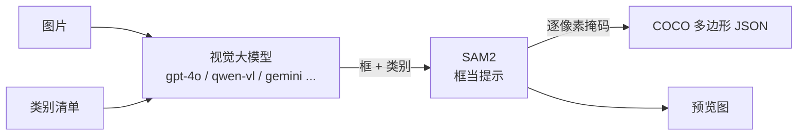

# vlm-auto-annotation

用**视觉大模型**做识别、用 **SAM2** 做描边的自动标注工具。输入一张图和一份类别清单，
输出可直接导入 CVAT 的 COCO 实例分割标注。



## 为什么不用现成的预标注模型

用 COCO 训练的 YOLO 只能输出那 80 个固定类别。实际场景里的"胶棒""指甲钳""笔筒"
它完全没有概念，只能往最接近的类上硬凑——把墙认成电视、把耳机盒认成鼠标。

视觉大模型靠常识能认对"这是什么"，但它给的框不够精确，不适合直接当标注。
**所以分工：大模型负责语义，SAM2 负责几何。**

实测对比（同一张桌面照片，10 个自定义类别）：

| 方案 | 认出类别 | 典型错误 |
| --- | --- | --- |
| YOLO-World（开放词表小模型） | 1 / 10 | 墙 → tv，耳机盒 → mouse |
| **VLM + SAM2** | 8 / 10 | 漏检 2 类，无误判 |

## 安装

```bash
pip install -r requirements.txt
```

要求 Python ≥ 3.9。`ultralytics` 会带上 torch，首次安装约 2 GB。

SAM2 权重首次运行时自动下载到 `models/`（约 75 MB，已在 `.gitignore` 里排除）。

## 快速开始

```bash
export VLM_API_KEY=sk-xxxxxxxx

python auto_annotate.py \
  --image desk.jpg \
  --api-base https://api.openai.com/v1 \
  --model gpt-4o \
  --classes "monitor,cup,cell phone,stapler,ink bottle" \
  --out out/
```

**建议先 `--dry-run`**，只跑大模型、不跑 SAM2，几秒就能判断它认类别和位置准不准：

```bash
python auto_annotate.py ... --dry-run
```

## 支持的接口

任何 **OpenAI 兼容**的 `chat/completions`（带 `image_url`）都能用：

| 平台 | `--api-base` | `--model` 示例 |
| --- | --- | --- |
| OpenAI | `https://api.openai.com/v1` | `gpt-4o` |
| 阿里通义 | `https://dashscope.aliyuncs.com/compatible-mode/v1` | `qwen-vl-max` |
| 智谱 | `https://open.bigmodel.cn/api/paas/v4` | `glm-4v-plus` |
| OpenRouter | `https://openrouter.ai/api/v1` | 任意视觉模型 |
| OpenCode Go | `https://opencode.ai/inference/go/openai/v1` | `qwen4-max`、`gemini-4-argon` |
| 本地 vLLM / Ollama | `http://127.0.0.1:8000/v1` | 你部署的模型 |

> OpenCode 有两个通道：`/zen/v1` 是按量计费，`/inference/go/openai/v1` 才是订阅额度。
> 用错通道会报 `Insufficient balance`。

## 参数

| 参数 | 默认 | 说明 |
| --- | --- | --- |
| `--image` | 必填 | 输入图片 |
| `--classes` | — | 类别清单，逗号分隔 |
| `--classes-file` | — | 类别清单文件，每行一个，支持 `#` 注释 |
| `--api-base` | `$VLM_API_BASE` 或 OpenAI | 接口地址，要带 `/v1` |
| `--api-key` | `$VLM_API_KEY` | 建议用环境变量，别写进命令行历史 |
| `--model` | `$VLM_MODEL` 或 `gpt-4o` | 视觉模型名 |
| `--seg-model` | `models/sam2.1_t.pt` | SAM2 权重路径，不存在会自动下载；`t/s/b/l` 越大越准越慢 |
| `--device` | `cpu` | `cpu` 或 `0`（第一块 GPU） |
| `--max-side` | `1280` | 送图前缩图的最长边，控制 token 成本 |
| `--out` | `autoanno_out` | 输出目录 |
| `--dry-run` | 关 | 只跑大模型 |
| `--save-raw` | 关 | 保存大模型原始回复，排查 JSON 解析问题 |
| `--prompt-file` | — | 自定义提示词模板，支持 `{classes}` 占位 |

## 输出

```
out/
├── preview_boxes.jpg    只有大模型的框 —— 先看这张判断"认得准不准"
├── detections.json      大模型结果 + 坐标换算后的框 + token 用量
├── coco_instances.json  COCO 实例分割标注
└── preview.jpg          框 + SAM2 掩码叠加 —— 看"描边贴不贴"
```

`coco_instances.json` 是标准 COCO 格式，可以直接：

- 在 **CVAT** 里：任务页 → Upload annotations → 选 `COCO 1.0`
- 转 YOLO 分割格式训练（自己写个几十行的转换脚本，或直接用 ultralytics 的 `convert_coco`）

**阶段格式说明**：一个物体对应一条 annotation。一个物体如果有多个不连通的区域，
那几段多边形放在同一条 annotation 的 `segmentation` 列表里（COCO 就是这么定义的）。
同样，小于整图 0.05% 的碎片会被过滤掉。

## 常见问题

**1. 返回 403，`error code: 1010`**

Cloudflare 按 User-Agent 拦掉了 `python-urllib`。脚本已内置浏览器 UA，如果你改过
`build_headers()` 记得保留。

**2. 返回 400，`MissingSessionID`**

OpenCode Go 通道要求 `x-opencode-session` 头。脚本会检测 `api-base` 里是否含
`opencode.ai`，含则自动加一个 UUID。

**3. 框的位置整体偏移或缩小**

模型把坐标当成了别的尺度。脚本支持 0~1、0~1000、绝对像素三种写法，靠数值大小判断。
提示词里明确要求 0~1000 可以避免歧义——如果你换了提示词模板，请保留这条要求。

**4. 某些类别一直漏检**

- 把类名写得更具体：`glue stick` → `white glue stick bottle`，`pen holder` → `pencil cup`
- 换更强的视觉模型（同一个接口换个 `--model` 就行）
- 降低对"漏检"的期待：自动标注的定位是**减少描边工作量**，不是完全替代人工

**5. SAM2 太慢**

- GPU：`--device 0`
- 换更小的权重：`sam2.1_t.pt`（默认已是最小）
- 只对大目标跑 SAM2，小目标直接用框

## 成本与速度参考

单张 1280×720 图片（实测）：

| 环节 | 耗时（CPU） | token |
| --- | --- | --- |
| 视觉大模型识别 | 10–40 秒 | 约 1100 输入 / 1000 输出 |
| SAM2 tiny 描边 | 5–20 秒 | — |

GPU 上 SAM2 会快 10 倍以上。大模型那部分延迟取决于服务商。

## 已知限制

- **漏检比误判更常见**：宁可漏也别编，提示词里已经这么要求了
- **小目标框不稳**：VLM 对大物体的定位明显好于小物体，SAM2 也救不了框偏太远的情况
- **不适合无文字提示的通用分割**：类别必须是你列出来的那些
- **一次一张图**：批量请在外面套一层循环

## 许可

MIT
