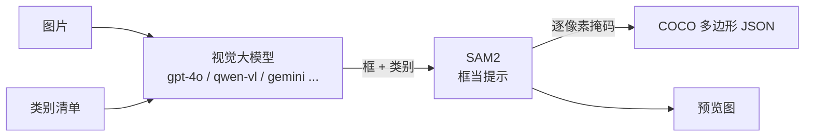

# vlm-auto-annotation

用**视觉大模型**做识别、用 **SAM2** 做描边的自动标注工具。输入一张图和一份类别清单，
输出可直接导入 CVAT 的 COCO 实例分割标注。



## 为什么不用现成的预标注模型

用 COCO 训练的 YOLO 只能输出那 80 个固定类别。实际场景里的"胶棒""指甲钳""笔筒"
它完全没有概念，只能往最接近的类上硬凑——把墙认成电视、把耳机盒认成鼠标。

视觉大模型靠常识能认对"这是什么"，但它给的框不够精确，不适合直接当标注。
**所以分工：大模型负责语义，SAM2 负责几何。**

实测对比（同一张桌面照片，10 个自定义类别）：

| 方案 | 认出类别 | 典型错误 |
| --- | --- | --- |
| YOLO-World（开放词表小模型） | 1 / 10 | 墙 → tv，耳机盒 → mouse |
| **VLM + SAM2** | 8 / 10 | 漏检 2 类，无误判 |

## 文件

| 文件 | 作用 |
| --- | --- |
| `auto_annotate.py` | 主程序：VLM 识别 + SAM2 描边 → COCO（单张） |
| `batch_annotate.py` | 批量：遍历目录 + 断点续跑，SAM2 整批只加载一次 |
| `coco2yolo.py` | COCO → YOLO 分割数据集（可直接训练） |
| `benchmark_models.py` | 多个视觉模型横评（覆盖率 / 自一致性 / 掩码质量） |
| `list_models.py` | 列出接口上可用的模型，标出哪些能看图 |
| `examples/classes.txt` | 类别清单示例 |

## 安装

```bash
pip install -r requirements.txt
```

要求 Python ≥ 3.9。`ultralytics` 会带上 torch，首次安装约 2 GB。

SAM2 权重首次运行时自动下载到 `models/`（约 75 MB，已在 `.gitignore` 里排除）。

## 统一入口（推荐）

环境有几处坑（venv、conda 的 libstdc++、ultralytics 配置目录），`run.sh` 全包了：

```bash
export VLM_API_KEY=sk-xxx

./run.sh models                    # 列出可用模型（只看能看图的）
./run.sh one --image a.jpg --classes "cup,monitor"          # 单张
./run.sh batch --images DIR --classes-file examples/classes.txt   # 批量
./run.sh bench --image a.jpg --models m1 m2 --with-sam     # 横评
./run.sh convert --coco "runs/*/coco_instances.json" --out dataset/   # 转数据集
```

它做三件事：挑一个装了 ultralytics 的 Python、把 `LD_LIBRARY_PATH` 指向 conda 的 lib、
把 `YOLO_CONFIG_DIR` 设到可写目录。想指定解释器：`VLM_PY=/path/to/python ./run.sh ...`。

**不建议**手敲 `LD_LIBRARY_PATH=... python xxx.py`——很容易把变量写成脚本路径，
然后报 `xxx.py：未找到命令`。

## 快速开始

```bash
export VLM_API_KEY=sk-xxxxxxxx

python auto_annotate.py \
  --image desk.jpg \
  --api-base https://api.openai.com/v1 \
  --model gpt-4o \
  --classes "monitor,cup,cell phone,stapler,ink bottle" \
  --out out/
```

**建议先 `--dry-run`**，只跑大模型、不跑 SAM2，几秒就能判断它认类别和位置准不准：

```bash
python auto_annotate.py ... --dry-run
```

## 支持的接口

任何 **OpenAI 兼容**的 `chat/completions`（带 `image_url`）都能用：

| 平台 | `--api-base` | `--model` 示例 |
| --- | --- | --- |
| OpenAI | `https://api.openai.com/v1` | `gpt-4o` |
| 阿里通义 | `https://dashscope.aliyuncs.com/compatible-mode/v1` | `qwen-vl-max` |
| 智谱 | `https://open.bigmodel.cn/api/paas/v4` | `glm-4v-plus` |
| OpenRouter | `https://openrouter.ai/api/v1` | 任意视觉模型 |
| OpenCode Go | `https://opencode.ai/inference/go/openai/v1` | `qwen4-max`、`gemini-4-argon` |
| 本地 vLLM / Ollama | `http://127.0.0.1:8000/v1` | 你部署的模型 |

> OpenCode 有两个通道：`/zen/v1` 是按量计费，`/inference/go/openai/v1` 才是订阅额度。
> 用错通道会报 `Insufficient balance`。

## 参数

| 参数 | 默认 | 说明 |
| --- | --- | --- |
| `--image` | 必填 | 输入图片 |
| `--classes` | — | 类别清单，逗号分隔 |
| `--classes-file` | — | 类别清单文件，每行一个，支持 `#` 注释 |
| `--api-base` | `$VLM_API_BASE` 或 OpenAI | 接口地址，要带 `/v1` |
| `--api-key` | `$VLM_API_KEY` | 建议用环境变量，别写进命令行历史 |
| `--model` | `$VLM_MODEL` 或 `gpt-4o` | 视觉模型名 |
| `--seg-model` | `models/sam2.1_t.pt` | SAM2 权重路径，不存在会自动下载；`t/s/b/l` 越大越准越慢 |
| `--device` | `cpu` | `cpu` 或 `0`（第一块 GPU） |
| `--max-side` | `1280` | 送图前缩图的最长边，控制 token 成本 |
| `--out` | `autoanno_out` | 输出目录 |
| `--dry-run` | 关 | 只跑大模型 |
| `--save-raw` | 关 | 保存大模型原始回复，排查 JSON 解析问题 |
| `--prompt-file` | — | 自定义提示词模板，支持 `{classes}` 占位 |

## 输出

```
out/
├── preview_boxes.jpg    只有大模型的框 —— 先看这张判断"认得准不准"
├── detections.json      大模型结果 + 坐标换算后的框 + token 用量
├── coco_instances.json  COCO 实例分割标注
└── preview.jpg          框 + SAM2 掩码叠加 —— 看"描边贴不贴"
```

`coco_instances.json` 是标准 COCO 格式，可以直接：

- 在 **CVAT** 里：任务页 → Upload annotations → 选 `COCO 1.0`
- 转 YOLO 分割格式训练（自己写个几十行的转换脚本，或直接用 ultralytics 的 `convert_coco`）

**阶段格式说明**：一个物体对应一条 annotation。一个物体如果有多个不连通的区域，
那几段多边形放在同一条 annotation 的 `segmentation` 列表里（COCO 就是这么定义的）。
同样，小于整图 0.05% 的碎片会被过滤掉。

## 批量跑

单张用 `auto_annotate.py`，整个目录用 `batch_annotate.py`：

```bash
export VLM_API_KEY=sk-xxx
export VLM_MAX_TOKENS=16000        # 用推理模型时必需

# 先跑 3 张验证
python batch_annotate.py --images ~/yolo-pritice/datasets/desktop/raw \
    --classes-file examples/classes.txt --model claude-haiku-5-5 \
    --api-base https://opencode.ai/inference/go/openai/v1 \
    --out runs --limit 3

# 全量
python batch_annotate.py --images ~/yolo-pritice/datasets/desktop/raw \
    --classes-file examples/classes.txt --model claude-haiku-5-5 \
    --api-base https://opencode.ai/inference/go/openai/v1 \
    --out runs --resume
```

相比自己写 for 循环，它多做三件事：

| 能力 | 说明 |
| --- | --- |
| SAM2 只加载一次 | 整批复用，省掉每张图 10~30 秒的加载时间 |
| `--resume` 断点续跑 | 已生成 `coco_instances.json` 的图自动跳过；中断后重跑只补没做完的 |
| 单张失败不中断整批 | 失败记进 `batch_report.json`，最后汇总，退出码为 2 |

产物：`runs/<图片名>/{coco_instances.json, preview.jpg, detections.json}`
和 `runs/batch_report.json`（含各类别检出统计、从未检出的类别、平均耗时）。

## 转成训练用的数据集

`auto_annotate.py` 输出的是 COCO，直接训练不行。用 `coco2yolo.py` 转成 YOLO 分割数据集：

```bash
# 单张（val 复用 train，只够跑通流程）
python coco2yolo.py --coco out/coco_instances.json --out dataset/

# 多张 + 二八分（正式训练用这个）
python coco2yolo.py --coco "runs/*/coco_instances.json" \
    --classes-file examples/classes.txt --val-split 0.2 --out dataset/
```

产物：

```
dataset/
├── images/train/    images/val/
├── labels/train/    labels/val/
├── data.yaml        ultralytics 直接吃
└── convert_report.json
```

然后就能训练了：

```bash
yolo segment train model=yolo26n-seg.pt data=dataset/data.yaml epochs=100 imgsz=640
```

几个关键点：

- **`--classes-file` 一定要固定**，否则不同批次跑出来的类别编号会错位，数据集就没法合并
- **`--val-split` 默认 0**，此时 `val` 指向 `train`。这样训练出来的指标是虚高的，只适合验证流程能不能跑通
- **多段掩码只保留最大的一段**：YOLO 分割每行只能一个多边形，模型给出的碎片段会被丢弃（`convert_report.json` 里有计数）

## 先看有哪些模型可用

```bash
export VLM_API_KEY=sk-xxx
python list_models.py --api-base https://opencode.ai/inference/go/openai/v1 --vision-only
```

输出会列出每个模型的上下文长度、支持的输入类型（image / video / audio）和官方描述。
元数据只能当参考——**最终必须拿自己的图跑一次**，因为"支持图像"不等于"在你的场景认得好"。

## 怎么挑视觉模型

用 `benchmark_models.py` 横评，不要用 shell 循环——只比"检出几个框"会得出错误结论。

```bash
export VLM_API_KEY=sk-xxx
python benchmark_models.py \
  --image desk.jpg \
  --classes-file examples/classes.txt \
  --api-base https://opencode.ai/inference/go/openai/v1 \
  --models qwen4-max claude-haiku-5-5 gemini-4-argon \
  --repeat 2 --out bench/
```

它给四类信号：

| 信号 | 含义 |
| --- | --- |
| 类别覆盖 | 清单里几类被找到（漏检是主要失败模式） |
| 检出框数 | 有没有重复框或凭空多出来的框 |
| **自一致性 IoU** | 同一张图跑两次，框是否稳定。**不需要标注真值就能测** |
| 耗时 / token | 成本 |

产物：`bench/side_by_side.jpg`（各模型框并排）、`bench/benchmark.md`（对比表）、`bench/benchmark.json`。

### 加 `--with-sam` 连分割一起评

```bash
python benchmark_models.py --image desk.jpg --classes-file examples/classes.txt \
  --models qwen3.8-max deepseek-v4.1-flash claude-haiku-5-5 \
  --with-sam --out bench_seg/
```

会额外给出 **掩码占全图比例** 和 **碎片化对象数**（一个物体被切成几段），
并给每个模型写出 `*_coco.json`，可转成训练集。

### 推理模型的陷阱

`deepseek-v4.1-flash`、`gpt-6-luna` 这类推理模型，会把输出预算先花在思考上。
默认 `max_tokens=4000` 时它返回 **空正文 + `finish_reason=length`**，看起来像"模型不会看图"。
实际是没来得及输出答案。用 `VLM_MAX_TOKENS` 调大：

```bash
export VLM_MAX_TOKENS=16000
```

实测该模型需要约 8300 个 reasoning token 才能答完。

### 实测案例（一张桌面图，10 个自定义类别）

| 模型 | 框 | 覆盖 | 自一致性 | 观察 |
| --- | ---: | ---: | ---: | --- |
| `qwen4-max` | 8 | 80% | **0.86** | 框最紧，每个都贴物体 |
| `claude-haiku-5-5` | 11 | **100%** | 0.81 | 找得全，但有类别混淆 |
| `gemini-4-argon` | 10 | 90% | **0.37** | 框是巨大的重叠区域，不可用 |

**教训**：`gemini-4-argon` 覆盖 90%，只看覆盖率会选它，但它的框完全不能用。
自一致性（0.37）和并排图揭穿了这一点。

判断顺序建议：**先看 side_by_side.jpg 排除框歪的，再看覆盖率和自一致性选剩下的**。

## 常见问题

**1. 返回 403，`error code: 1010`**

Cloudflare 按 User-Agent 拦掉了 `python-urllib`。脚本已内置浏览器 UA，如果你改过
`build_headers()` 记得保留。

**2. 返回 400，`MissingSessionID`**

OpenCode Go 通道要求 `x-opencode-session` 头。脚本会检测 `api-base` 里是否含
`opencode.ai`，含则自动加一个 UUID。

**3. 框的位置整体偏移或缩小**

模型把坐标当成了别的尺度。脚本支持 0~1、0~1000、绝对像素三种写法，靠数值大小判断。
提示词里明确要求 0~1000 可以避免歧义——如果你换了提示词模板，请保留这条要求。

**4. 某些类别一直漏检**

- 把类名写得更具体：`glue stick` → `white glue stick bottle`，`pen holder` → `pencil cup`
- 换更强的视觉模型（同一个接口换个 `--model` 就行）
- 降低对"漏检"的期待：自动标注的定位是**减少描边工作量**，不是完全替代人工

**5. SAM2 太慢**

- GPU：`--device 0`
- 换更小的权重：`sam2.1_t.pt`（默认已是最小）
- 只对大目标跑 SAM2，小目标直接用框

## 成本与速度参考

单张 1280×720 图片（实测）：

| 环节 | 耗时（CPU） | token |
| --- | --- | --- |
| 视觉大模型识别 | 10–40 秒 | 约 1100 输入 / 1000 输出 |
| SAM2 tiny 描边 | 5–20 秒 | — |

GPU 上 SAM2 会快 10 倍以上。大模型那部分延迟取决于服务商。

## 已知限制

- **漏检比误判更常见**：宁可漏也别编，提示词里已经这么要求了
- **小目标框不稳**：VLM 对大物体的定位明显好于小物体，SAM2 也救不了框偏太远的情况
- **不适合无文字提示的通用分割**：类别必须是你列出来的那些
- **一次一张图**：批量请在外面套一层循环

## 许可

MIT
